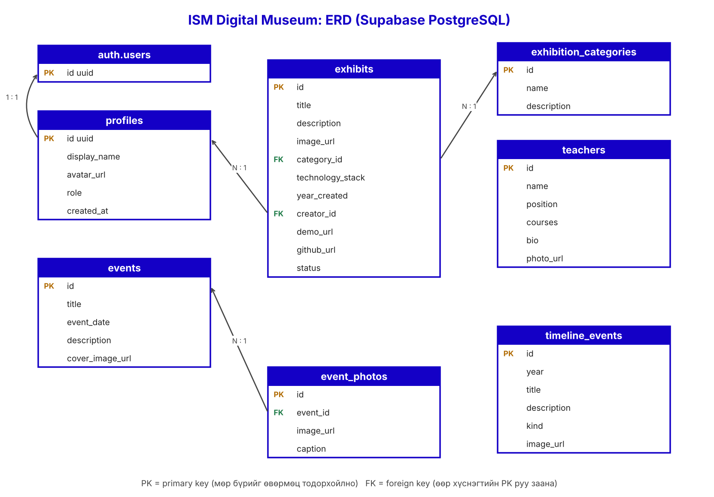

# Өгөгдлийн сангийн схем (ERD)

## Хүснэгтүүд ба холбоо
| Холбоо | Тайлбар |
|---|---|
| `profiles.id` → `auth.users.id` (1:1) | Supabase Auth-ийн хэрэглэгч бүрт нэг профайл. Бүртгүүлэхэд trigger автоматаар үүсгэнэ |
| `exhibits.creator_id` → `profiles.id` (N:1) | Нэг оюутан олон бүтээлтэй. RLS-ийн үндэс (`creator_id = auth.uid()`) |
| `exhibits.category_id` → `exhibition_categories.id` (N:1) | Үзмэрийн ангилал |
| `event_photos.event_id` → `events.id` (N:1) | Нэг арга хэмжээнд олон зураг. Арга хэмжээ устахад зураг дагаж устна (`on delete cascade`) |
| `teachers`, `timeline_events` | Бусад хүснэгттэй холбоогүй, админ удирдана |

## Primary key ба foreign key-ийн зориулалт
- **Primary key (`id`)**: мөр бүрийг давтагдашгүй тодорхойлно, мөрийг шууд олох, засах, устгахад ашиглана.
- **Foreign key**: нэг хүснэгтийн мөрийг нөгөө хүснэгтийн PK руу заана. Ингэснээр өгөгдөл бүрэн бүтэн (байхгүй ангилал, хэрэглэгчийг заах боломжгүй) байх ба JOIN-оор холбоотой өгөгдлийг нэг query-ээр авна (жишээ нь үзмэр + ангиллын нэр + зохиогчийн нэр).
